# java项目-ssm汽车在线销售系统-ssm毕业设计-带论文

> 🎓 **计算机毕业设计 · java项目-ssm汽车在线销售系统-ssm毕业设计-带论文**
>
> 本仓库只放**项目介绍 + 运行截图**（截图是站点带水印的原图，存在仓库 `images/` 里）。
>
> 👉 **完整可运行源码 / 数据库脚本 / 部署文档：[点我获取](https://geekcode.top/archives/java%E9%A1%B9%E7%9B%AE-ssm%E6%B1%BD%E8%BD%A6%E5%9C%A8%E7%BA%BF%E9%94%80%E5%94%AE%E7%B3%BB%E7%BB%9F-ssm%E6%AF%95%E4%B8%9A%E8%AE%BE%E8%AE%A1-%E5%B8%A6%E8%AE%BA%E6%96%87?utm_source=github)**
>
> 💬 咨询微信：**ir9372**　|　🌐 更多项目：[极客代码 geekcode.top](https://geekcode.top/?utm_source=github)
>
> 📌 项目详情页：<https://geekcode.top/archives/java%E9%A1%B9%E7%9B%AE-ssm%E6%B1%BD%E8%BD%A6%E5%9C%A8%E7%BA%BF%E9%94%80%E5%94%AE%E7%B3%BB%E7%BB%9F-ssm%E6%AF%95%E4%B8%9A%E8%AE%BE%E8%AE%A1-%E5%B8%A6%E8%AE%BA%E6%96%87?utm_source=github>

<table><td width="230" align="center"> <b>扫码加微信 ir9372</b></td><td valign="middle">📦 源码 = 项目介绍 + 全部运行截图 + 数据库 + 部署文档 👉 点上方任意截图，直接跳到 <b>极客代码 geekcode.top</b> 详情页</td></table>

---

<h1>java项目-ssm汽车在线销售系统-ssm毕业设计-带论文</h1>
<h2>项目概述</h2>

本项目为基于 SSM（Spring + Spring MVC + MyBatis）架构开发的汽车在线销售系统，旨在构建一个高效、稳定的纯后端 API 服务平台。系统核心聚焦于车辆信息的数字化管理、在线交易流程支撑及用户交互反馈机制。主要功能涵盖车辆信息展示、新闻资讯发布、留言反馈处理以及订单状态跟踪等模块。适用人群包括需要快速搭建后端数据接口以对接前端页面的开发者，或作为毕业设计课题验证 Java Web 开发能力的学生。技术架构上，采用 Spring 框架进行依赖注入与事务管理，MyBatis-Plus 简化持久层操作，Druid 提供高性能数据库连接池支持，确保了系统在数据读写频繁场景下的稳定性与响应速度。

<h2>技术架构</h2>

本系统采用经典的三层架构设计模式，具体技术选型如下：

<ol>
<li><strong>控制层（Controller）</strong>：基于 <code>spring-web</code> 和 <code>spring-webmvc</code> 构建 RESTful API 接口。通过注解方式定义路由映射，负责接收 HTTP 请求、参数校验及调用业务逻辑层方法。</li>
<li><strong>业务逻辑层（Service）</strong>：利用 <code>spring-core</code>、<code>spring-context</code> 实现 Bean 的管理与依赖注入，结合 <code>spring-tx</code> 处理事务一致性，确保购车下单、库存更新等操作的数据完整性。</li>
<li><strong>持久层（DAO/Mapper）</strong>：集成 <code>mybatis-plus</code> 作为 ORM 框架，大幅减少 XML 配置文件，通过内置 CRUD 方法快速实现数据库交互。使用 <code>druid</code> 作为数据库连接池，提供监控与优化能力。</li>
<li><strong>辅助组件</strong>：引入 <code>junit</code> 用于单元测试，保障代码质量；<code>spring-aop</code> 可能用于日志记录或权限拦截等横切关注点。</li>
</ol>

数据库设计围绕实体对象展开，主要包括车辆信息表、订单表、用户表、新闻表及评论表等，通过外键关联维持数据关系的一致性。

<a href="https://geekcode.top/archives/java%E9%A1%B9%E7%9B%AE-ssm%E6%B1%BD%E8%BD%A6%E5%9C%A8%E7%BA%BF%E9%94%80%E5%94%AE%E7%B3%BB%E7%BB%9F-ssm%E6%AF%95%E4%B8%9A%E8%AE%BE%E8%AE%A1-%E5%B8%A6%E8%AE%BA%E6%96%87?utm_source=github" title="查看完整源码">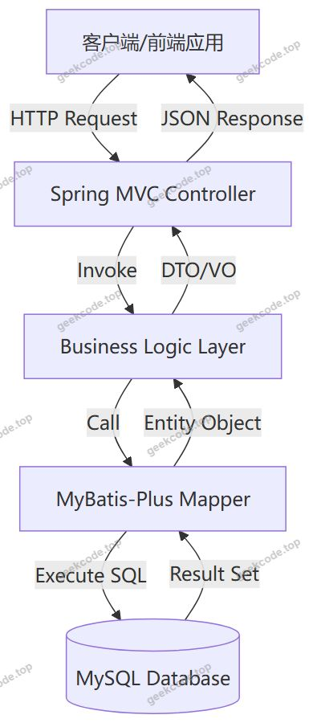</a>

<h2>功能模块</h2>

根据源码中的 Controller 列表及截图显示的功能菜单，系统主要包含以下后端接口模块：

<h3>1. 车辆信息管理模块</h3>
<ul>
<li><strong>CheliangxinxiController</strong>：负责车辆基本信息（如车型、品牌、价格、库存、图片等）的增删改查接口。</li>
<li><strong>QicheleixingController</strong>：管理汽车类型分类（如轿车、SUV、跑车等），支持动态维护分类字典。</li>
<li><strong>QichepinpaiController</strong>：管理汽车品牌数据，提供品牌列表查询及品牌详情接口。</li>
</ul>
<h3>2. 交易与订单模块</h3>
<ul>
<li><strong>ChelianggoumaiController</strong>：处理车辆购买请求，生成初步订单数据，关联用户与车辆信息。</li>
<li><strong>DingdanzhuangtaiController</strong>：追踪订单生命周期状态（如待支付、已发货、已完成等），提供状态更新接口。</li>
<li><strong>ChukujiluController</strong>：记录车辆出库信息，与销售订单联动，确保库存扣减有据可查。</li>
</ul>
<h3>3. 内容与互动模块</h3>
<ul>
<li><strong>NewsController</strong>：发布和管理平台新闻资讯，支持文章内容的创建与检索。</li>
<li><strong>DiscusscheliangxinxiController</strong>：处理用户对特定车辆的讨论与评论，建立车辆与用户评价的多对多关系。</li>
<li><strong>MessagesController</strong>：管理系统的通用消息通知或站内信功能。</li>
</ul>
<h3>4. 系统与基础服务模块</h3>
<ul>
<li><strong>CommonController</strong>：提供公共工具类接口，如验证码生成、通用上传下载处理等。</li>
<li><strong>ConfigController</strong>：管理系统配置项，如网站名称、联系方式、开关设置等。</li>
<li><strong>FileController</strong>：专门处理文件上传服务，支持车辆图片、新闻配图等非结构化数据的存储与管理。</li>
</ul>
<h2>用户角色与权限</h2>

由于项目类型为 pure-api 且未明确列出复杂的 RBAC（基于角色的访问控制）权限表结构，根据现有 Controller 命名规范及常规 SSM 系统设计推断，系统主要涉及两类隐含角色及其对应的接口访问权限：

<h3>1. 普通用户（前台访客/注册会员）</h3>
<ul>
<li><strong>浏览权限</strong>：访问 <code>CheliangxinxiController</code>、<code>QicheleixingController</code>、<code>QichepinpaiController</code> 获取车辆列表、分类和品牌信息。</li>
<li><strong>内容消费</strong>：读取 <code>NewsController</code> 发布的资讯，查看 <code>DiscusscheliangxinxiController</code> 中的公开评论。</li>
<li><strong>交互操作</strong>：通过 <code>ChelianggoumaiController</code> 提交购买意向，使用 <code>DiscusscheliangxinxiController</code> 发表新评论，或通过 <code>MessagesController</code> 发送留言反馈。</li>
<li><strong>个人中心</strong>：查询自身订单状态（<code>DingdanzhuangtaiController</code>），管理个人收藏（虽无独立 Controller，通常复用 User 相关接口）。</li>
</ul>
<h3>2. 管理员（后台操作人员）</h3>
<ul>
<li><strong>数据维护</strong>：拥有对所有 <code>Controller</code> 的完整 CRUD（增删改查）权限。</li>
<li>新增/编辑/删除车辆信息 (<code>CheliangxinxiController</code>)。</li>
<li>管理品牌和类型字典 (<code>QichepinpaiController</code>, <code>QicheleixingController</code>)。</li>
<li>发布和管理新闻 (<code>NewsController</code>)。</li>
<li>审核或删除违规评论 (<code>DiscusscheliangxinxiController</code>)。</li>
<li><strong>业务监管</strong>：</li>
<li>查看所有订单并手动更新状态 (<code>DingdanzhuangtaiController</code>)。</li>
<li>录入出库记录，确认发货 (<code>ChukujiluController</code>)。</li>
<li>处理用户留言反馈 (<code>MessagesController</code>)。</li>
<li><strong>系统配置</strong>：修改全局参数 (<code>ConfigController</code>)，管理用户上传的文件资源 (<code>FileController</code>)。</li>
</ul>

<em>注：具体接口是否通过 Token 或 Session 区分权限，需结合前端调用逻辑确定，但上述功能划分符合标准电商后台管理需求。</em>

<h2>项目特色与创新点</h2>
<ol>
<li><strong>轻量级高效持久层</strong>：摒弃传统 MyBatis 繁琐的 XML 映射配置，采用 MyBatis-Plus 实现零 SQL 编码的基础 CRUD，显著提升开发效率与维护性。</li>
<li><strong>模块化清晰的分层设计</strong>：严格遵循单一职责原则，将车辆基础数据、交易流程、内容运营分离为独立的 Controller 组，便于后续微服务化拆分或功能扩展。</li>
<li><strong>完善的文件与配置管理</strong>：内置专门的 <code>FileController</code> 和 <code>ConfigController</code>，解决了静态资源存储困难和硬编码配置的问题，提升了系统的灵活性和用户体验。</li>
<li><strong>闭环的业务流程支持</strong>：从车辆展示、类型筛选、新闻引流到购买下单、状态跟踪、出库记录，形成了完整的汽车销售业务数据闭环，具备实际商业落地价值。</li>
</ol>
<h2>部署环境</h2>

为确保系统正常运行，建议配置以下软件环境：

<ul>
<li><strong>操作系统</strong>：Windows 10/11, Linux (CentOS 7+/Ubuntu 20.04+)</li>
<li><strong>Java 版本</strong>：JDK 1.8 及以上（推荐 JDK 1.8 以兼容主流 SSM 框架版本）</li>
<li><strong>数据库</strong>：MySQL 5.7 或 MySQL 8.0</li>
<li><strong>构建工具</strong>：Maven 3.6+</li>
<li><strong>Web 服务器</strong>：Tomcat 9.x (若打包为 WAR) 或 Spring Boot 内置 Tomcat (若打包为 JAR)</li>
<li><strong>其他依赖</strong>：无需 Node.js 或微信开发者工具，因为该项目为纯后端 API 服务，前端页面需另行开发或使用 Postman/curl 进行测试。</li>
</ul>
<h2>五、技术特性</h2>
<ul>
<li>使用 MyBatis-Plus 简化数据访问层开发</li>
</ul>
<h2>六、功能模块截图</h2>
<h3>前台用户端</h3>
<h4>登录页</h4>

<h4>页面-用户列表</h4>

<a href="https://geekcode.top/archives/java%E9%A1%B9%E7%9B%AE-ssm%E6%B1%BD%E8%BD%A6%E5%9C%A8%E7%BA%BF%E9%94%80%E5%94%AE%E7%B3%BB%E7%BB%9F-ssm%E6%AF%95%E4%B8%9A%E8%AE%BE%E8%AE%A1-%E5%B8%A6%E8%AE%BA%E6%96%87?utm_source=github" title="查看完整源码">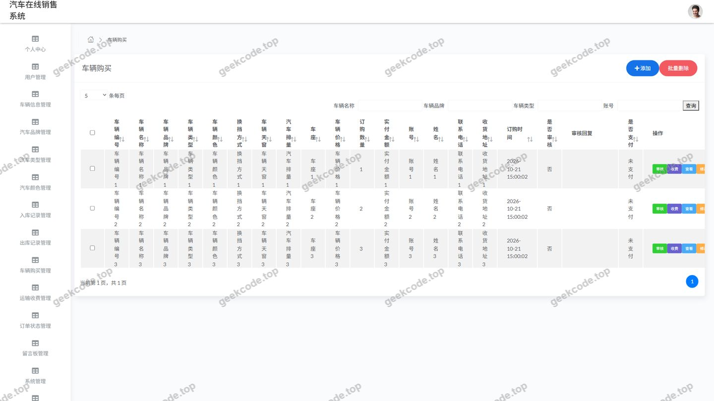</a>

<h4>页面-用户列表</h4>

<a href="https://geekcode.top/archives/java%E9%A1%B9%E7%9B%AE-ssm%E6%B1%BD%E8%BD%A6%E5%9C%A8%E7%BA%BF%E9%94%80%E5%94%AE%E7%B3%BB%E7%BB%9F-ssm%E6%AF%95%E4%B8%9A%E8%AE%BE%E8%AE%A1-%E5%B8%A6%E8%AE%BA%E6%96%87?utm_source=github" title="查看完整源码">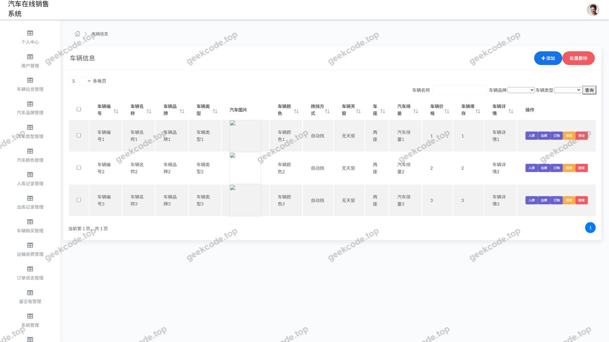</a>

<h4>页面-用户列表</h4>

<a href="https://geekcode.top/archives/java%E9%A1%B9%E7%9B%AE-ssm%E6%B1%BD%E8%BD%A6%E5%9C%A8%E7%BA%BF%E9%94%80%E5%94%AE%E7%B3%BB%E7%BB%9F-ssm%E6%AF%95%E4%B8%9A%E8%AE%BE%E8%AE%A1-%E5%B8%A6%E8%AE%BA%E6%96%87?utm_source=github" title="查看完整源码">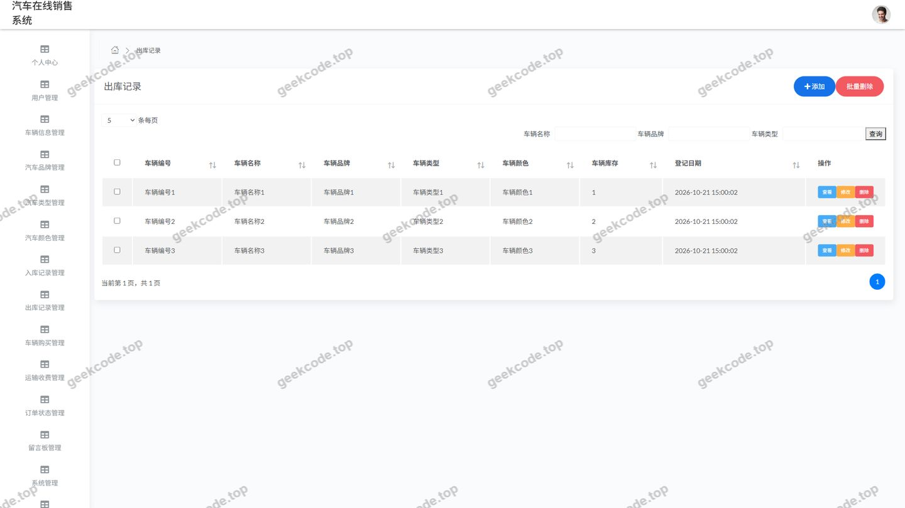</a>

<h4>页面-用户列表</h4>

<a href="https://geekcode.top/archives/java%E9%A1%B9%E7%9B%AE-ssm%E6%B1%BD%E8%BD%A6%E5%9C%A8%E7%BA%BF%E9%94%80%E5%94%AE%E7%B3%BB%E7%BB%9F-ssm%E6%AF%95%E4%B8%9A%E8%AE%BE%E8%AE%A1-%E5%B8%A6%E8%AE%BA%E6%96%87?utm_source=github" title="查看完整源码">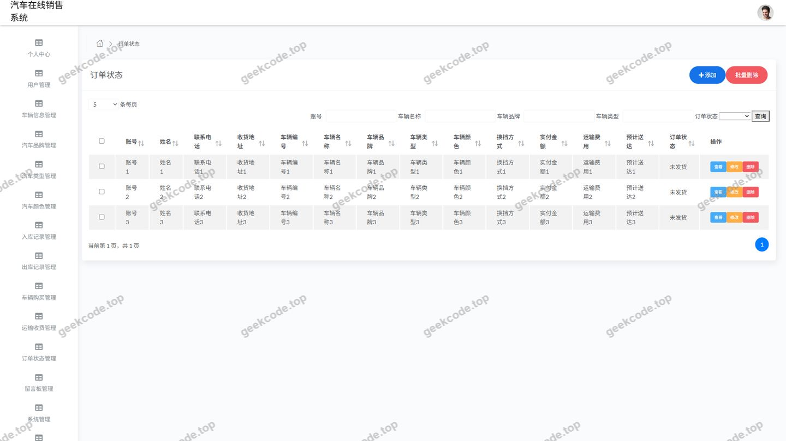</a>

<h4>页面-用户列表</h4>

<a href="https://geekcode.top/archives/java%E9%A1%B9%E7%9B%AE-ssm%E6%B1%BD%E8%BD%A6%E5%9C%A8%E7%BA%BF%E9%94%80%E5%94%AE%E7%B3%BB%E7%BB%9F-ssm%E6%AF%95%E4%B8%9A%E8%AE%BE%E8%AE%A1-%E5%B8%A6%E8%AE%BA%E6%96%87?utm_source=github" title="查看完整源码">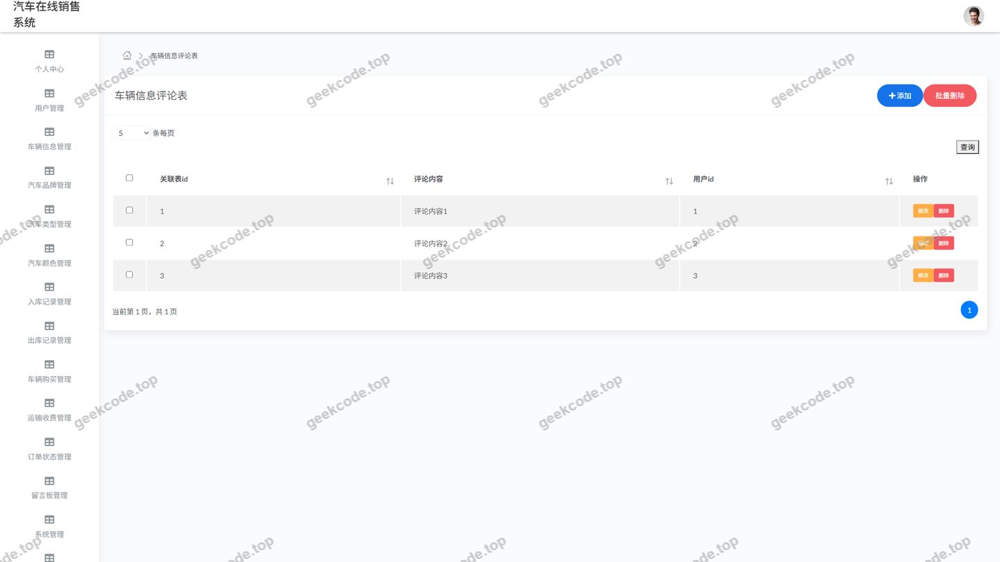</a>

<h4>页面-用户列表</h4>

<a href="https://geekcode.top/archives/java%E9%A1%B9%E7%9B%AE-ssm%E6%B1%BD%E8%BD%A6%E5%9C%A8%E7%BA%BF%E9%94%80%E5%94%AE%E7%B3%BB%E7%BB%9F-ssm%E6%AF%95%E4%B8%9A%E8%AE%BE%E8%AE%A1-%E5%B8%A6%E8%AE%BA%E6%96%87?utm_source=github" title="查看完整源码">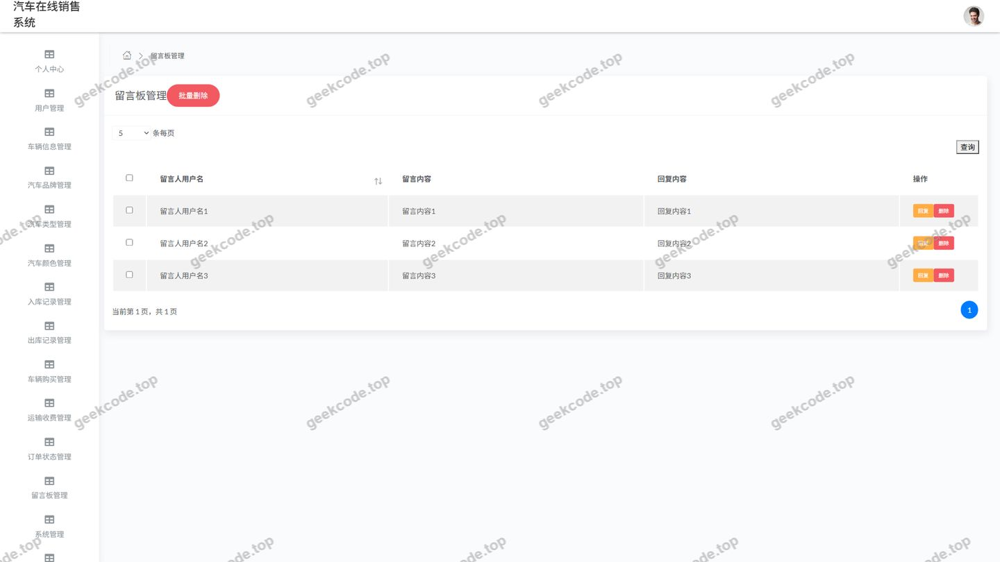</a>

<h4>页面-用户列表</h4>

<a href="https://geekcode.top/archives/java%E9%A1%B9%E7%9B%AE-ssm%E6%B1%BD%E8%BD%A6%E5%9C%A8%E7%BA%BF%E9%94%80%E5%94%AE%E7%B3%BB%E7%BB%9F-ssm%E6%AF%95%E4%B8%9A%E8%AE%BE%E8%AE%A1-%E5%B8%A6%E8%AE%BA%E6%96%87?utm_source=github" title="查看完整源码">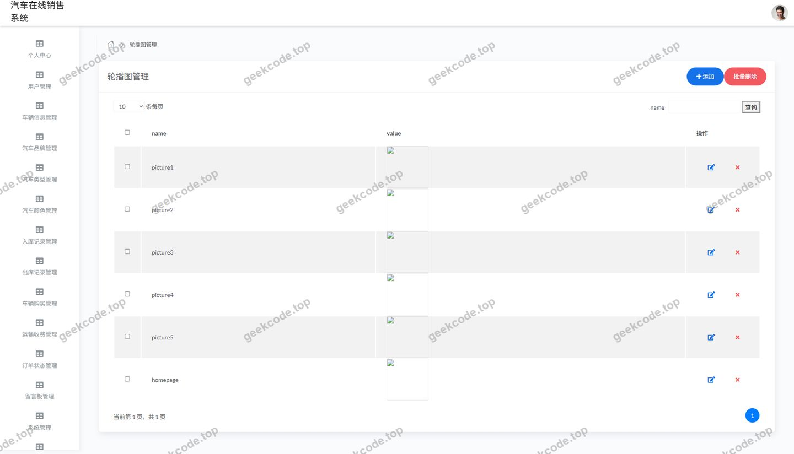</a>

<h4>页面-用户列表</h4>

<a href="https://geekcode.top/archives/java%E9%A1%B9%E7%9B%AE-ssm%E6%B1%BD%E8%BD%A6%E5%9C%A8%E7%BA%BF%E9%94%80%E5%94%AE%E7%B3%BB%E7%BB%9F-ssm%E6%AF%95%E4%B8%9A%E8%AE%BE%E8%AE%A1-%E5%B8%A6%E8%AE%BA%E6%96%87?utm_source=github" title="查看完整源码">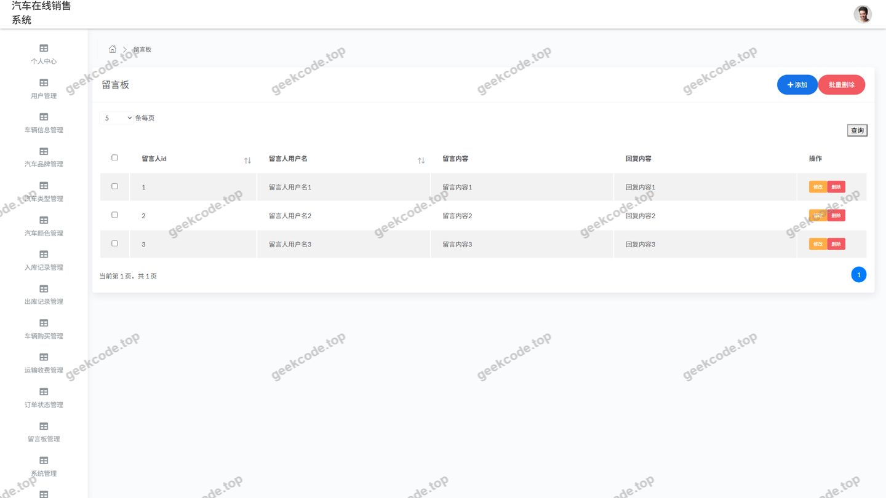</a>

<h4>页面-用户列表</h4>

<a href="https://geekcode.top/archives/java%E9%A1%B9%E7%9B%AE-ssm%E6%B1%BD%E8%BD%A6%E5%9C%A8%E7%BA%BF%E9%94%80%E5%94%AE%E7%B3%BB%E7%BB%9F-ssm%E6%AF%95%E4%B8%9A%E8%AE%BE%E8%AE%A1-%E5%B8%A6%E8%AE%BA%E6%96%87?utm_source=github" title="查看完整源码">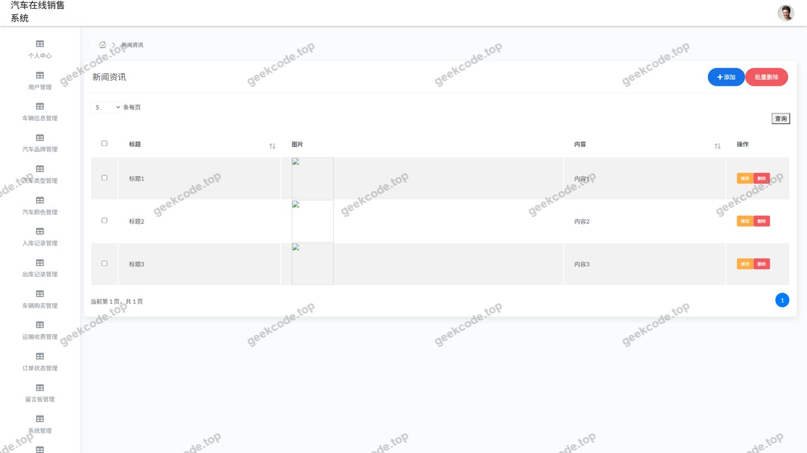</a>

<h4>页面-用户列表</h4>

<a href="https://geekcode.top/archives/java%E9%A1%B9%E7%9B%AE-ssm%E6%B1%BD%E8%BD%A6%E5%9C%A8%E7%BA%BF%E9%94%80%E5%94%AE%E7%B3%BB%E7%BB%9F-ssm%E6%AF%95%E4%B8%9A%E8%AE%BE%E8%AE%A1-%E5%B8%A6%E8%AE%BA%E6%96%87?utm_source=github" title="查看完整源码">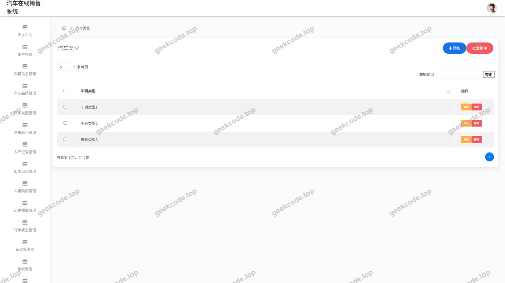</a>

<h4>页面-用户列表</h4>

---

## 获取完整源码

| 项目 | 说明 |
| --- | --- |
| 项目名 | java项目-ssm汽车在线销售系统-ssm毕业设计-带论文 |
| 运行截图 | 本文 13 张（站点带水印原图，仓库 `images/` 目录） |
| 完整源码 | [https://geekcode.top/archives/java%E9%A1%B9%E7%9B%AE-ssm%E6%B1%BD%E8%BD%A6%E5%9C%A8%E7%BA%BF%E9%94%80%E5%94%AE%E7%B3%BB%E7%BB%9F-ssm%E6%AF%95%E4%B8%9A%E8%AE%BE%E8%AE%A1-%E5%B8%A6%E8%AE%BA%E6%96%87?utm_source=github](https://geekcode.top/archives/java%E9%A1%B9%E7%9B%AE-ssm%E6%B1%BD%E8%BD%A6%E5%9C%A8%E7%BA%BF%E9%94%80%E5%94%AE%E7%B3%BB%E7%BB%9F-ssm%E6%AF%95%E4%B8%9A%E8%AE%BE%E8%AE%A1-%E5%B8%A6%E8%AE%BA%E6%96%87?utm_source=github) |
| 咨询微信 | **ir9372**（备注：jingpin-yuanma） |
| 更多项目 | [极客代码 geekcode.top](https://geekcode.top/?utm_source=github) |

> 需要源码、部署、改配置、跑不起来等问题，加微信 ir9372 沟通，说明项目名即可。
